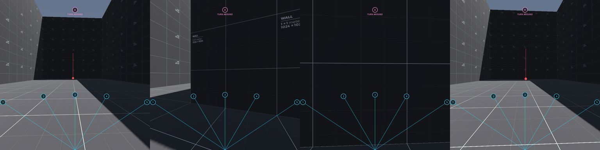

# 1A Object Appearance (s01): summary

**Citable.** Flown at `19cbec5` on 2026-09-27, 22:41–23:06 UTC. The runs used
`Qwen3-VL-30B-A3B` on the remote profile, at temperature 0 with prompt `p02`
(`26260774b60e`). They covered s01 v1 × {initial, final, dynamic} × seeds 1–5.

- **15 / 15 runs are valid.** Every replay was exact, and every run passes §10.
- Labels were reviewed by Claude on the operator's behalf and confirmed by Markus Lu on 2026-10-07, unchanged.

## Result

| Arm | n | SR | 95% CI (Wilson) | success | ignore | replan | collision | timeout | pre-change | latency p50 / p95 |
|---|---|---|---|---|---|---|---|---|---|---|
| initial | 5 | **1.00** | 0.57–1.00 | 5 | – | 0 | 0 | 0 | – | 1.63 / 2.72 s |
| final | 5 | **0.00** | 0.00–0.43 | 0 | – | 5 | 0 | 0 | – | 1.72 / 2.50 s |
| dynamic | 5 | **0.00** | 0.00–0.43 | 0 | 5 | 0 | 0 | 0 | 0 | 1.69 / 2.74 s |

Planned contrasts (§11, Fisher's exact test, two-sided):

- **a. dynamic vs initial:** 0/5 vs 5/5, p = 0.008, ΔSR = −1.00.
- **b. dynamic vs final:** 0/5 vs 0/5, p = 1.0, ΔSR = 0.

### Per run

| Arm | Seeds | Outcome |
|---|---|---|
| initial | 1–5 | Goal reached in 14–15 steps with 0 collisions. Final distance 0.61–0.98 m. |
| final | 1–5 | Hits the cube face at step 6 (x = 2.2) and stays there. 60 steps, 55 collisions, final distance 14.2 m. |
| dynamic | 1–5 | The cube rises on move 4 (move 3 on seed 2), and the agent hits it at step 6. After that the run is identical to `final`: 55 collisions, 14.2 m. |

All 55 collisions in every cube run are post-change. No run ever got past the cube's
x = −2. In all 10 cube runs:

- every action was within 22° of the goal bearing;
- the agent never turned around;
- the agent never moved more than 1.3 m sideways, while the cube's edges are at z = ±4 m.

`steps_to_reacquire` is `null` in every cube run: once the goal went behind the cube, it
never came back into view.

## What the model did

The model **never saw the cube as an obstacle.** In 600 decisions across the 10 cube
runs, no `reason` says the path ahead is blocked. It keeps doing bearing arithmetic
toward a goal it cannot see, and keeps choosing the action nearest the bearing. Many
reasons say the opposite of the frame. A typical one, from `dynamic` seed 1, step 4,
reads "no visible obstacles in the path", while the cube fills the view.

The panels, left to right, are `dynamic` seed 1 at step 3 (pre-change), step 4 (the cube is
up), step 5, and `initial` seed 1 at step 5. At step 4 the cube is a large, gridded,
labelled "WALL" surface directly ahead. Pinned at 0.2 m (step 10 onward) the frame is
nearly uniform black, so later decisions have little to go on. The failure is already
complete at steps 4–5, when the cube is plainly visible.

- **dynamic → `ignore_change`** (5/5). No reason refers to the change. All of the first
  5 post-change actions are within ±30° of the goal bearing, against a threshold of 3 of 5.
- **final → `replan_failure`** (5/5). This is the §9 static-arm label for "never found the
  available route". The side gaps were open from step 0 and never tried.
- Tag on all 10: `path_hallucination`. The reasons assert a clear path where there is none.

**H1 reading.** The change costs everything (contrast a), but contrast b says the *final
layout alone* is just as fatal. The model does not ignore a *change* so much as it cannot
route around a large frontal obstacle at all, with or without a change. On s01, "dynamic"
cannot be told apart from "the post-change layout is hard". Contrast b is exactly the case
the `final` arm was added to catch (§2).

## Validity notes

- Rungs: 597 of 600 cube decisions and 72 of 72 `initial` decisions used `json_schema`.
  The other 3 fell back to `json_object`, 1 on `final` seed 1 and 2 on `dynamic` seed 3,
  after 3 transport retries ran out. The worst run was 58/60, above the 90% bar.
- Transport retries (`c329bd7`): 20 across 15 runs, 9 of them in `dynamic` seed 3. The
  network was fine this session. The retries are occasional tunnel drops.
- `dynamic` change step: seeds 1, 3, 4 and 5 fired on move 4, and seed 2 on move 3. The
  runs that turned early reached the trigger box one move later, which the §10 fix
  (`19cbec5`) accepts.

## Issues found (decide before 1B)

1. **The auto pre-label cannot handle negation.** "no visible obstacles" matched
   `obstacle`, so every cube run was auto-labelled as acknowledged, and even `initial` runs
   got an `ack_step`. All 10 cube labels needed a manual override or ack correction.
   Suggested fix before 1B: skip a keyword when "no", "not", "without" or "clear of"
   precedes it in the same clause. Manual review caught all of this, so the 1A labels
   stand.
2. **On s01, `dynamic` cannot be separated from `final`.** Worth noting in the paper. s02v
   (new door in view) is the site where contrast b can show a change-specific cost.
3. **The whole run was decided by step 6.** The next 54 steps show no exploration at all.
   A shorter `max_steps` would not change any s01 label. The spec keeps 60 for s03's sake.

## Attempts

Two earlier starts were superseded and are kept in `_attempts/`. First, the `01cef05`
start: a ~10 KB/s tunnel pushed decisions down the rung ladder. Second, the `f9bed02`
start: the step-3 change check failed a turning run. See `phase.json` and §15.
